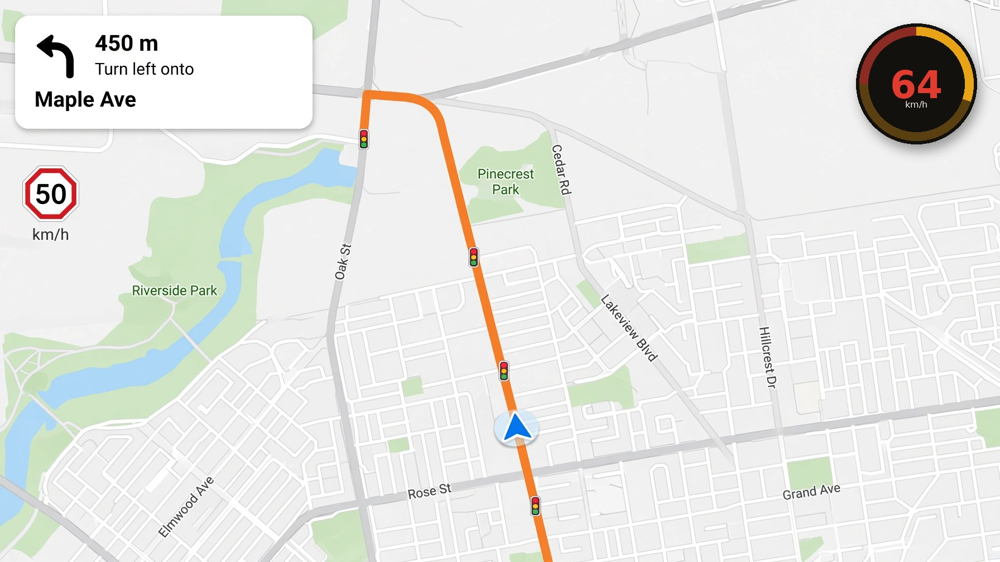

# Overmark

Overmark watches the speed of this device. While you stay over a limit you choose, a short beep marks every second. After 45 seconds an alarm sounds and the speed flashes red. Drop under the limit and the count starts over.

The limit starts at 90 km/h and moves in steps of 0.5 km/h. The app opens directly in the language of the device. The language list is not the first screen. A language you choose yourself stays on that device. Only the language and the speed limit are kept. Exit clears temporary files. No account, no analytics, nothing is sent.

If the screen is off and speed is over the limit, Overmark posts a notification. On Android that notification is visible on the lock screen. The phone keeps listening for GPS while tracking is armed.

Disclaimer and About are separate pages.

## Download

The newest Basic package is [overmark-basic-1.7.1.apk](https://github.com/Claudiu1975/Overmark/releases/download/v1.7.1/overmark-basic-1.7.1.apk). The release page is [v1.7.1](https://github.com/Claudiu1975/Overmark/releases/tag/v1.7.1).

Pro is not published as a download. Compile it yourself from this source, or search the Google Play Store for Overmark Pro.

## Overmark Pro

We made a better version with a floating gauge that can stay above your navigation app. Once set, our app runs in the background and lets you do your work. We work hard for the price of a coffee.



The compiled Pro app is not published here. Compile it yourself from this source, or search the Google Play Store for Overmark Pro.

```bash
cd android
./gradlew assembleProRelease
```

## What's new in 1.7.3 Pro

The Google Play package is now `com.overmark.pro`. This is a new paid Play app. The older `com.overmark.app` listing stays as it is and is not used for this release. Basic is unchanged at 1.7.1.

## What's new in 1.7.1

Rebuilt on the stable 1.5.0 base, so the app starts again. Test does not crash without location permission. On Android 15 the screen stays clear of the status bar and the navigation buttons. Translations are fixed in every language. Settings shows a preview of the Overmark Pro floating gauge.

The package is [overmark-basic-1.7.1.apk](https://github.com/Claudiu1975/Overmark/releases/download/v1.7.1/overmark-basic-1.7.1.apk) on the [v1.7.1 release](https://github.com/Claudiu1975/Overmark/releases/tag/v1.7.1).

## What's new in 1.6.4 Pro

Test runs without location permission. Arming a simulated speed no longer crashes when location is missing, denied, or revoked, and the same is true if notifications are blocked. Basic 1.6.3 has the same fix.

## What's new in 1.6.3 Basic

Test runs without location permission. Arming a simulated speed no longer crashes when location is missing, denied, or revoked. The package is [overmark-basic-1.6.3.apk](https://github.com/Claudiu1975/Overmark/releases/download/v1.6.3/overmark-basic-1.6.3.apk) on the [v1.6.3 release](https://github.com/Claudiu1975/Overmark/releases/tag/v1.6.3).

## What's new in 1.6.2 Pro

Same as Basic. Language is on the main screen. About holds the description, the navigation photo, the gauge size, and the legal text. There is no Settings page in between.

## What's new in 1.6.2 Basic

Basic only. The empty Settings page is removed. Language and About now return to the main screen.

## What's new in 1.6.1 Basic

Basic only. Language is an icon on the main screen. About shows the Pro description, a landscape navigation photo with the gauge, and the legal text under that. Pro is unchanged.

## What's new in 1.6.0

Overmark is split in two.

- **Overmark Pro** (`com.overmark.pro`) keeps the floating gauge. This is the paid Google Play app.
- **Overmark Basic** (`com.overmark.basic`) is the free app. It has no floating gauge. Settings shows screenshots of Pro and a description. The purchase link comes later.

## What's new in 1.5.1

- Works on Android 7.0 and newer.

## What's new in 1.5.0

- Language, About and Disclaimer are a sub menu of Settings, and Settings is at the bottom of the screen.
- Bench is now called Test.
- European languages only.
- Contact: goanga.ro, admin@goanga.ro.

The full archive is [CHANGELOG.md](CHANGELOG.md).

## Contact

goanga.ro · admin@goanga.ro

## Open source

This is an open source project. Everyone is invited to contribute.

Repository: https://github.com/Claudiu1975/Overmark

License: [Apache-2.0](LICENSE).

## F-Droid

The Android app is prepared for F-Droid. Store text and the icon live in `fastlane/metadata/android/en-US/`. The metadata file to submit is [fdroid/com.overmark.app.yml](fdroid/com.overmark.app.yml). Tag `v1.4.0` is the build F-Droid should compile.

```bash
cd android
./gradlew assembleRelease
```

## Version archive

| Version | Package |
| --- | --- |
| 1.7.1 Basic | [overmark-basic-1.7.1.apk](https://github.com/Claudiu1975/Overmark/releases/download/v1.7.1/overmark-basic-1.7.1.apk) |
| 1.6.3 Basic | [overmark-basic-1.6.3.apk](https://github.com/Claudiu1975/Overmark/releases/download/v1.6.3/overmark-basic-1.6.3.apk) |
| 1.6.2 Basic | [overmark-basic-1.6.2.apk](https://github.com/Claudiu1975/Overmark/releases/download/v1.6.2/overmark-basic-1.6.2.apk) |
| 1.6.0 Basic | [overmark-basic-1.6.0.apk](https://github.com/Claudiu1975/Overmark/releases/download/v1.6.0-play/overmark-basic-1.6.0.apk) |
| 1.5.0 | [overmark-1.5.0.apk](https://github.com/Claudiu1975/Overmark/releases/download/v1.5.0/overmark-1.5.0.apk) |
| overmark-android-7 | [overmark-android-7.apk](https://github.com/Claudiu1975/Overmark/releases/download/v1.5.1/overmark-android-7.apk) |
| 1.4.0 | [overmark-1.4.0.apk](https://github.com/Claudiu1975/Overmark/releases/download/v1.4.0/overmark-1.4.0.apk) |
| 1.3.0 | [overmark-1.3.0.apk](https://github.com/Claudiu1975/Overmark/releases/download/v1.3.0/overmark-1.3.0.apk) |
| 1.2.0 | [overmark-1.2.0.apk](https://github.com/Claudiu1975/Overmark/releases/download/v1.2.0/overmark-1.2.0.apk) |
| 1.1.0 | [overmark-1.1.0.apk](https://github.com/Claudiu1975/Overmark/releases/download/v1.1.0/overmark-1.1.0.apk) |

A newer build does not remove older packages.

## Try it

The web app includes a Test mode so the timer can be heard without driving.

```bash
npm install
npm run dev
```

The newest Basic package is [overmark-basic-1.7.1.apk](https://github.com/Claudiu1975/Overmark/releases/download/v1.7.1/overmark-basic-1.7.1.apk) ([v1.7.1](https://github.com/Claudiu1975/Overmark/releases/tag/v1.7.1)). Pro is not published as a download. Compile it yourself, or search the Google Play Store for Overmark Pro. It needs Android 7 or newer. Allow the browser to install it. Beeps use media volume. The alarm uses the alarm stream. Lock-screen alerts use the notification permission. The floating gauge needs permission to display over other apps.

To rebuild the APK, install Android SDK platform 34 and build-tools 34.0.0, then run `android/build.sh`. The debug keystore is created on the first build. The script writes the new package and leaves every older package in place.
